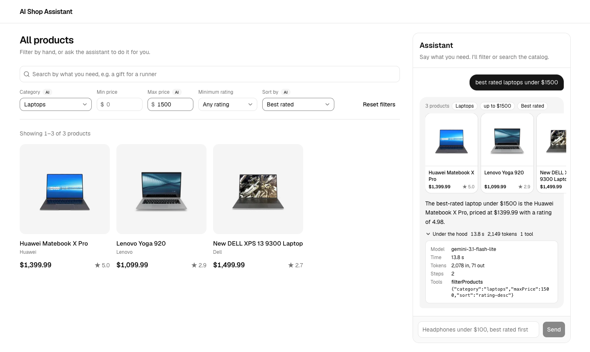
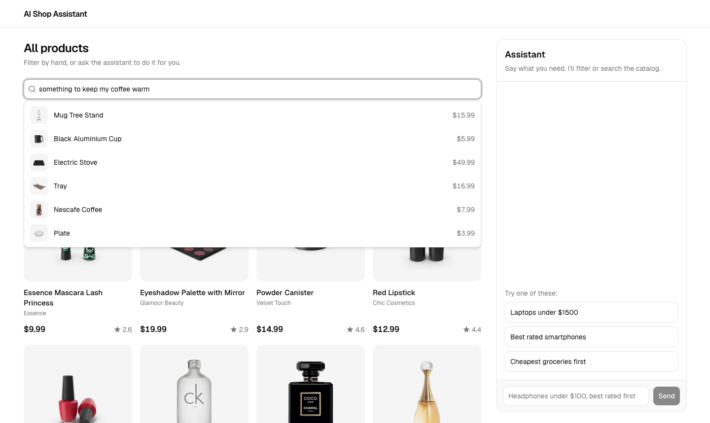
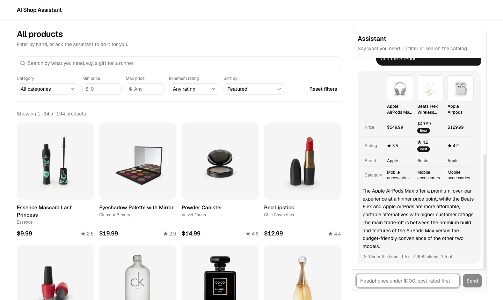
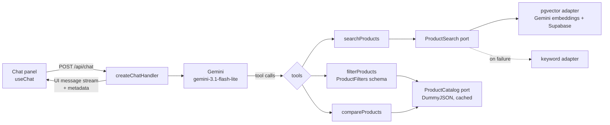

# AI Shop Assistant

A product catalog with an AI assistant beside it. Ask in plain language ("laptops under $1500, best rated first", "a gift for a runner", "compare the AirPods with the Beats") and the assistant filters the catalog, searches it by meaning, or compares products, with the results rendered as UI in the chat.

Built as a portfolio project to show **AI integration** (tool calling, generative UI, retrieval with embeddings, evals) and **production-grade engineering** (typed boundaries, ports and adapters, tests that target risk, graceful degradation).



## What it does

**Filters from plain language.** The model fills the same `ProductFilters` Zod schema that the filter controls and the URL use, so its input is validated by the domain contract before anything runs. The catalog follows the URL; filters the assistant set are marked "AI" until you change them.

**Search by meaning.** "headphones", "something to keep my coffee warm", "подарунок мамі на зиму": product descriptions are embedded with Gemini and stored in Supabase pgvector. The assistant searches when no category fits, and the search box suggests products as you type.



**Generative UI.** Answers render product cards and comparison tables, not just text. Product photos load by id through TanStack Query, so a product shown in a card and in a table is fetched once.



**Under the hood.** Every answer shows the model, time, tokens in and out, steps, and each tool call with its input.

## How it works



- **Feature-Sliced Design** (`app → features → entities → shared`), enforced by Steiger and ESLint. Business logic lives in framework-free `model/` folders; adapters live in `api/`.
- **Ports and adapters.** `ProductCatalog`, `ProductSearch`, and `RateLimiter` are interfaces; each route has one composition root that picks the adapters. Search adapters share a contract test suite.
- **Every boundary is parsed with Zod**: network responses, the URL, the environment, tool input, and the message metadata the client receives.
- **Server Components by default.** Filters and the search query live in the URL; the page re-renders on the server, and client components only update the URL.

The rules and the reasoning behind them are in [`docs/ARCHITECTURE.md`](docs/ARCHITECTURE.md).

## Production hardening

| Concern          | What happens                                                                                                                                            |
| ---------------- | ------------------------------------------------------------------------------------------------------------------------------------------------------- |
| AI down          | Search falls back to keyword search (`withFallback`); a failed chat offers "Search the catalog instead" with the same words.                            |
| Slow model       | Timeouts (20 s to first chunk, 45 s total) end in an error the user can act on, not an endless "Thinking…".                                             |
| Cost and abuse   | Per-IP rate limits (chat 12/min, search 60/min, `429` + `Retry-After`), 1000-character messages, 20 messages of history, 600 output tokens.             |
| Prompt injection | Shopping-only scope, instructions never revealed, user text and tool results treated as data, read-only tools with Zod-checked input. Checked by evals. |
| Repeated work    | Query embeddings cached in memory (0.44 s → 0.1 s); short `Cache-Control` on search and product routes; the catalog cached for hours.                   |
| Secrets          | Server-only env validated with Zod; the Supabase table has RLS on and is reachable only with the server's secret key.                                   |

## Testing

- **Unit and component tests** (Vitest, Testing Library, MSW) target risk: domain logic, adapters against their real wire formats, the chat handler with a mock model, and key UI flows. Coverage thresholds apply to `model/` and `api/`, and tests are mutation-checked to prove they fail when the code breaks.
- **Evals** (`npm run evals`) run 14 cases against the real model: the right tool with the right input for structured requests, semantic search for needs, and no tool and no leaked instructions for off-topic and injection prompts. Safety cases are a hard gate; tool choice must pass 90%. They run in CI when the assistant changes.

## Stack

Next.js 16 (App Router, Cache Components), React 19, TypeScript (strict), Tailwind CSS 4, shadcn/ui · Vercel AI SDK 7 with Gemini · Supabase (Postgres + pgvector) · TanStack Query · Zod 4 · Vitest, Testing Library, MSW · Steiger (FSD).

## Run it locally

```bash
npm install
cp .env.example .env   # add a Gemini key; Supabase is optional
npm run dev
```

- **Gemini key** (required for the chat): [Google AI Studio](https://aistudio.google.com/apikey).
- **Semantic search** (optional): create a Supabase project, apply `supabase/migrations/`, add `SUPABASE_URL` and `SUPABASE_SECRET_KEY`, then run `npm run index:products` to embed the catalog. Without Supabase, search uses keywords.

| Script                                    | Purpose                                                  |
| ----------------------------------------- | -------------------------------------------------------- |
| `npm test` / `npm run test:coverage`      | Unit and component tests                                 |
| `npm run evals`                           | Chat evals against the real model (uses quota)           |
| `npm run lint` / `lint:fsd` / `typecheck` | ESLint, architecture rules, types                        |
| `npm run index:products`                  | Sync product embeddings; re-embeds only changed products |

## Known limitations

- The in-memory rate limiter counts per server instance; many serverless instances need a shared store (e.g. Redis) behind the same `RateLimiter` port.
- The catalog comes from DummyJSON (194 products), so similarity scores sit in a narrow band; results are cut relative to the best match rather than at a fixed threshold.
- Free-tier Gemini quotas limit embedding throughput (the indexer waits between batches) and can slow answers; the Under-the-hood panel shows when it happens.
